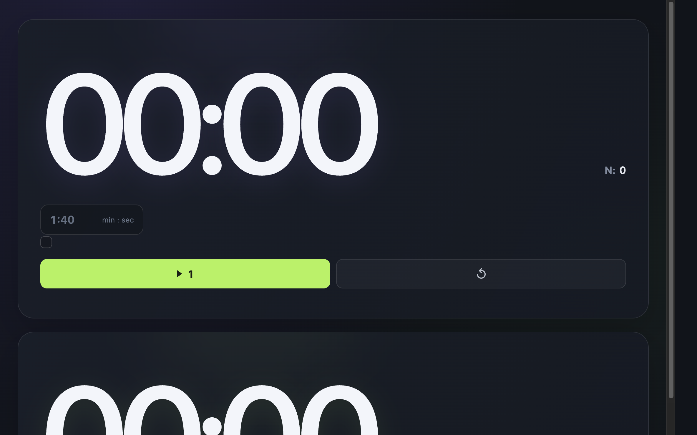
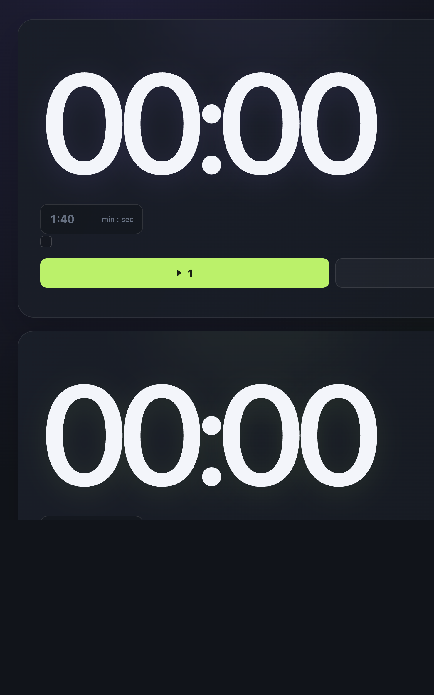

# 2x Timers

Two independent, looping countdown timers in a clean, responsive web page. The large displays keep both timers easy to read on desktop, tablet, and mobile.

## Screenshots

### Landscape

### Portrait

## Features

- Run two countdown timers independently.
- Pause, resume, or reset either timer without affecting the other.
- View each timer’s completed-cycle count as `N`.
- Choose whether each timer pauses between cycles; otherwise, it loops automatically.
- Hear an alarm when a cycle ends.
- Use numbered play controls to distinguish Timer 1 from Timer 2.
- Hover over icon-only controls to see their action.
- Responsive layout: controls sit beside the countdown on wide screens and below it on narrow screens.

## Using the timers

1. Enter a duration in either timer’s field.
2. Select **▶ 1** or **▶ 2** to start that timer. Select it again to pause or resume.
3. Use the reset icon to reset its countdown and cycle count.
4. Hover over the checkbox to see its **Pause between cycles** description, then enable it if you want to stop at the end of each cycle.

Duration formats:

- `1:40` — 1 minute, 40 seconds.
- `1.40` — 1 minute, 40 seconds. A single digit after the dot is treated as tens of seconds, so `1.4` also means 1:40.
- `5` — 5 minutes.

Keyboard shortcuts:

| Key | Action |
| --- | --- |
| Space | Start or pause Timer 1 |
| R | Reset Timer 1 |
| S | Start or pause Timer 2 |
| T | Reset Timer 2 |

## Run locally

Open `index.html` in a modern browser, or serve this folder with any static web server. No build step, package installation, Chrome extension, account, or application backend is required. Keep the page open while using the timers.

The alarm audio is included in `carol_of_the_bells-alarm.mp3`.

## Try it online

Run 2x Timers directly from the GitHub Pages website: [https://pc-aide.github.io/2xTimers/](https://pc-aide.github.io/2xTimers/).

## License

Distributed under the GNU GPL v3.0. See [LICENSE](LICENSE).
